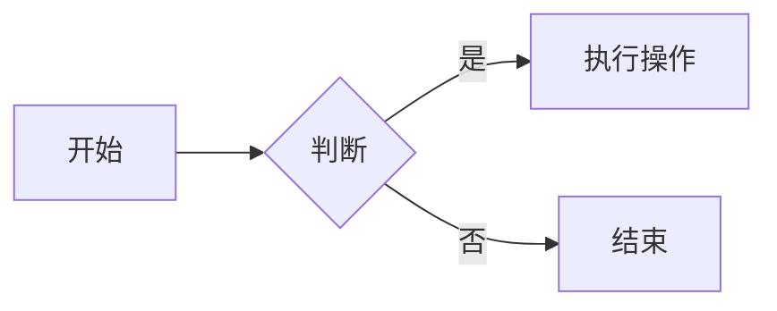

# Markdown 语法总结指南｜博客写作必备

> 本文示例全部使用 Markdown 编写，可以直接复制到支持 Markdown 的编辑器预览效果

## 前言

你是否厌烦在写文章时反复调整字体、行距、格式？Markdown 作为轻量级标记语言，只需要简单符号就可以完成排版，让我们专注内容本身，而不是样式。

读完本文你将掌握：Markdown 基础语法、GFM 扩展语法，以及写博客时经常遇到的坑。

## 什么是 Markdown

Markdown 是由 John Gruber 创建的**轻量级标记语言**，使用纯文本编写，可以轻松转换成 HTML。
日常博客平台大多使用 **GFM（GitHub Flavored Markdown）**，是原生 Markdown 的扩展版本，增加了表格、任务列表等实用功能。

> 
> ⚠️ 注意：不同平台渲染效果会存在细微差异。

## Markdown 的优势与适用场景

### ✅ 优点

1. 文件是纯文本，任意编辑器都可以打开，兼容性极强
2. 语法简单易学，专注写作，不用频繁调排版
3. 掘金、语雀、Notion、GitBook、个人博客等平台广泛支持

### 📌 适用场景

博客文章、项目 README、读书笔记、技术文档、笔记记录

### ❌ 局限性

不适合复杂图文排版，精细样式控制能力弱。

## 基础语法

### 标题

markddown中通过`#` 后面加上一个空格在跟着文字来标记标题

```markdown
# 一级标题
## 二级标题
### 三级标题
#### 四级标题
##### 五级标题
###### 六级标题
```

# 一级标题

## 二级标题

### 三级标题

### 段落与换行

普通文本直接写就是段落。
换行需要在行末尾加**两个空格**，再回车。或者也可以中间再间隔一行。
>注意：部分编辑器会做额外处理，直接按回车也会起一个新段落。上述为官方的mrakdown语法。

```
这是第一段文本。
这是第二段文本。

空一行代表新段落。
```
### 文字样式

在markdown中可以通过相关的符号来实现文本的加粗、斜体、删除线等视觉效果。

```
**粗体文本**
*斜体文本*
~~删除线文本~~（注意是英文下的波浪线）
***粗斜体文本***
```
**粗体文本**
*斜体文本*
~~删除线文本~~
***粗斜体文本***

### 列表

- 无序列表：使用`*`、`+`或`-`作为列表标记（后面需要加上一个空格）。
```
* 列表一
* 列表二
```

- 有序列表：使用数字加英文句点`.`（后面也需要加上一个空格）。
```
1. 第一项
2. 第二项 
```

- 嵌套列表：在子列表前缩进四个空格后面再采用无序或者有序列表。
```
* 列表一
	1. 一中的子列表1
	2. 一中的子列表2
* 列表二
	1. 二中的子列表1
	2. 二中的子列表2
```

### 引用快
markdown中用`>`来标识引用快，后面不需要需要加上一个空格，直接写文本。
```
> 这是一级引用。
>> 这是嵌套二级引用。
```
>这是一级引用。
>>这是嵌套二级引用。

### 行内代码 & 代码块
- 行内代码：使用单个反引号`` ` ``包裹住
``` 
`两个反引号之间包裹的内容将被显示为行内代码`
```
`两个反引号之间包裹的内容将被显示为行内代码块`

- 代码块：使用三个反引号```` ``` ````包围，并且可以在```` ``` ````后面加上编程语言以实现语法高亮

```c
#include <stdio.h>
int main(){
    printf("Hello Markdown");
    return 0;
}
```
>注意若要在行内代码块之间写入`` ` ``时，里面每增加一个`` ` ``，则两边就要多写一个反引号`` ` ``，例如若要显示 ```我在行内代码块中写了两个`` ```,则应该写 ```````` ```我在行内代码块中写了两个`` ```  ````````。
>>且要注意若反引号与代码块标记的反引号`` ` ``紧邻着，要加上空格。

### 分割线

在markdown中可以用三个以上的`*`、`-` 或者`_`来建立分割线，行内不能有其他内容

```
---
***
___
```

### 链接与图片
#### 链接
```markdown
[显示文字](https://example.com)
```
可选加标题（鼠标悬停时显示）：
```markdown
[显示文字](https://example.com "标题")
```
引用式写法（适合多处复用同一链接）：
```markdown
正文里面写：[显示文字][标识符]

文档末尾定义：[标识符]: https://example.com "标题"  注意有空格
```
>标识符规则
>- 标识符不区分大小写，[vscode] 和 [VSCode] 通常指向同一个定义。
>- 标识符可以包含字母、数字、空格、标点。
>- 定义时，冒号后面要至少有一个空格。
>- 标题可以用双引号、单引号或括号包裹：

[Nanithal](https://Nanithal.github.io)
[Nanithal](https://Nanithal.github.io "Nanithal的个人博客")

[Nanithal][res]
[ref]: https://Nanithal.github.io

#### 图片

图片语法= !+链接语法
```

```
可选加标题
```

```

引用式写法（同链接的引用式写法一致）
```
![替代文本][img1]

[img1]: ./img/photo.png
```
>标准markdown不支持直接控制图片尺寸，可以用标签。

#### 图片加链接（点击图片跳转链接）
```
[](https://Nanithal.github.io)
```


## GFM扩展语法（博客高频）

### 表格

使用`|`来分隔单元格，使用`-`来分隔表头和行，并且可以用`：`来控制对齐方式

```
| 姓名 | 年龄 | 城市 |
| ---- | ---- | ---- |对齐方式写在第二行
| 张三 | 25   | 北京 |
| 李四 | 30   | 上海 |
```
- 左对齐：`:---`
- 居中对齐：`:---:`
- 右对齐：`---:`
- 默认左对齐：`------`

| 姓名 | 年龄 | 城市 |
| ---- | ---- | ---- |
| 张三 | 25   | 北京 |
| 李四 | 30   | 上海 |
### 任务列表/复选框（Task Lists）
使用带有`[ ]`或者`[x]`（未选中/已选中）的列表项。
>注意`-`与`[]`之间有空格，且若为未选中时，`[]`中间有一个空格

``` 
- [X] 已完成任务
- [ ] 未完成任务
```

- [x] 已完成任务
- [ ] 未完成任务

### 脚注（Footnotes）

用于创建注释说明
```
这是一个带有脚注的文本[^1]。
[^1]:这里是脚注的具体	会自动放在文章末尾
```

这是一个带有脚注的文本[^1]。
[^1]: 这里是脚注的内容


### 徽标与特殊符号转义
- 转义字符：如果需要显示Markdown的语法字符（如`*`或者`#`），可以在前面加上反斜杠`\
	- 示例：`\*不加粗的星号\*` --> \*不加粗的星号\*
## 进阶语法（平台支持才生效）
>部分博客平台可能不支持下列语法
### 内嵌HTML
可以运用一些html知识
```html
<u>下划线文字</u>
```
<u>下划线文字</u>

### Mermaid流程图
```

```


### LaTeX数学公式

markdown中可以插入数学公式且渲染效果优秀
- 行内公式：用单个美元符号`$`包裹。例如：`E = mc^2`，$E = mc ^2$
- 块级公式：用双美元`$$`包裹
```
&&
\sum_{i=1}^{n} i = \frac{n(n+1)}{2}
&&
```
$$\sum_{i=1}^{n} i = \frac{n(n+1)}{2}$$