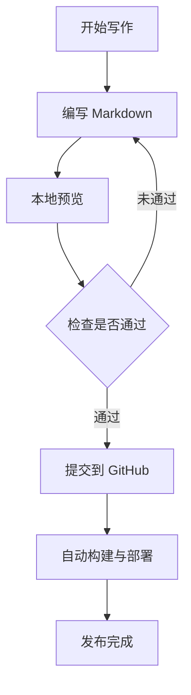
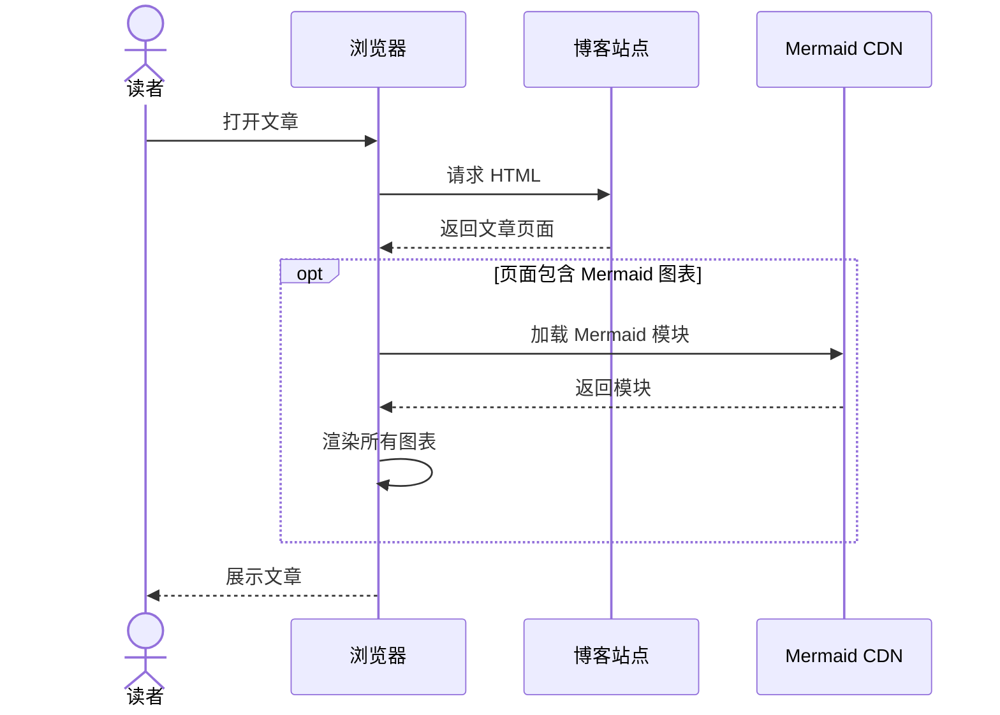
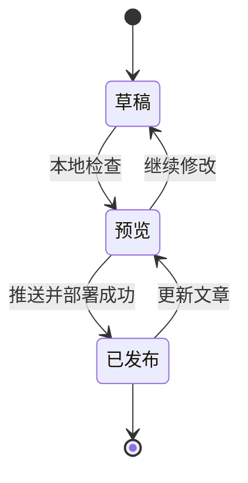
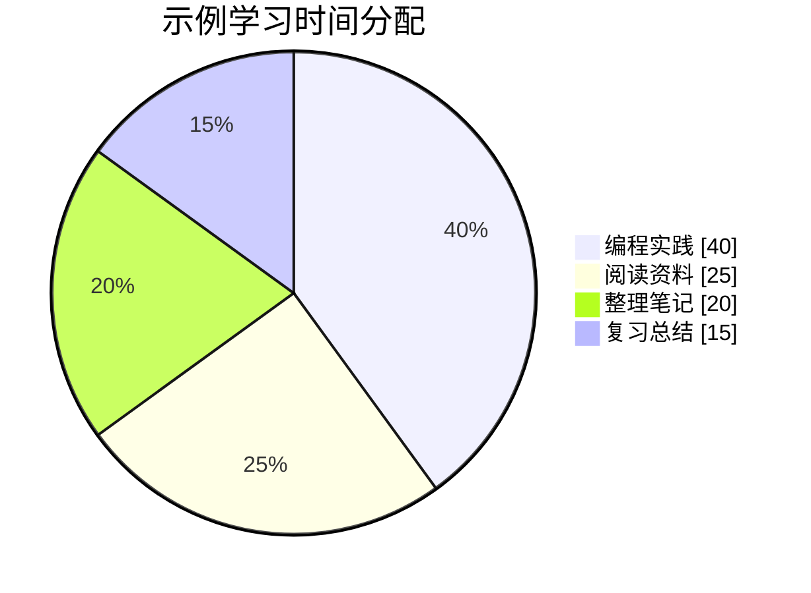

本文用于检查 Mermaid 在同一篇文章中的多图渲染，以及中文标签、分支和循环是否正常显示。

## 1. 流程图：中文、分支与循环

预期：显示从上到下的流程图，判断节点有“通过”和“未通过”两条分支。



## 2. 时序图：请求与响应

预期：显示读者、浏览器、博客站点和 CDN 四个参与者，以及请求和响应箭头。



## 3. 状态图：文章发布过程

预期：显示起点、终点以及草稿、预览、发布三个状态。



## 4. 饼图：中文图例

预期：显示四个扇区、中文图例和数值。这里使用的是示例数据。



## 5. 普通代码块对照

预期：下面保持 Python 代码高亮，不应被转换为 Mermaid 图表。

```python
def greet(name: str) -> str:
    return f"你好，{name}！"

print(greet("Nanithal"))
```

## 检查结果

- [ ] 四张图都显示为图形，没有只显示 Mermaid 源码。
- [ ] 中文标签清晰可读。
- [ ] 流程图分支和回退箭头正确。
- [ ] 时序图、状态图和饼图显示正常。
- [ ] 普通 Python 代码块仍保持代码格式。
- [ ] 刷新页面后所有图表仍能正常显示。

> 本文默认是草稿。使用 `hugo server -D --renderToMemory` 预览；需要正式发布时，将开头的 `draft: true` 改为 `draft: false`。
