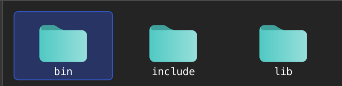
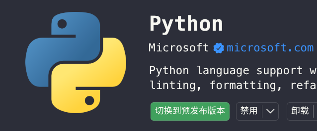
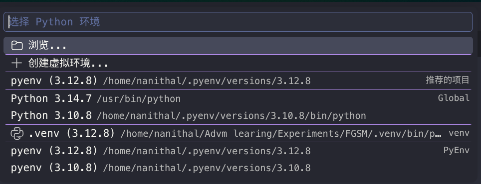
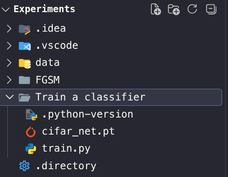
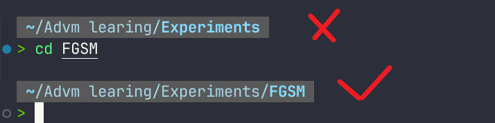
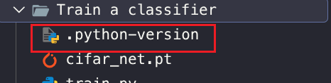
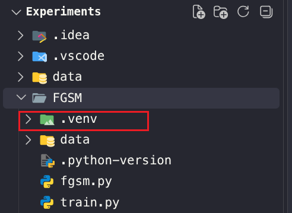
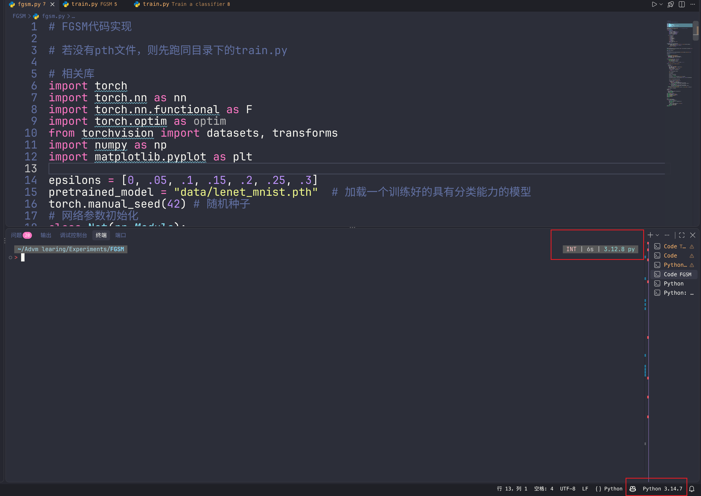
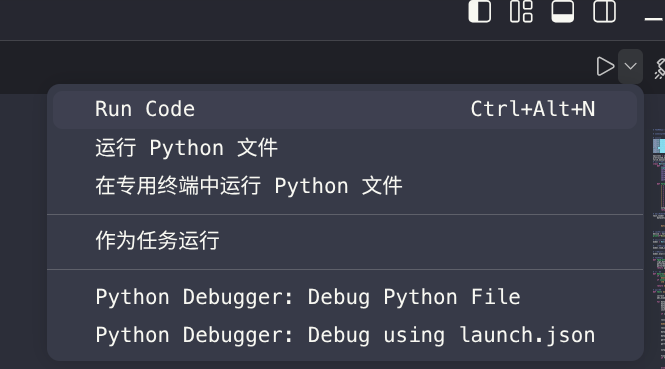

# 基于vscode的Linux下的多python解释器

**本文记录如何在Linux操作系统下构建vscode的多python解释器编程环境**。
>采用的是archlinux操作系统，不同发行版命令可能会有所不同。

## archlinux下的python解释
在安装linux操作系统时候，会**自动下载最新版本的python解释器**。这个解释器为**系统解释器**，将被安装在`/usr`目录下。具体如下：
```
/usr/bin/python3    可执行程序位置
/usr/include/python3.x  源码/头文件位置
/usr/lib/python3.x 安装的库位置
/usr/lib/python3.x/site-packages    site-packages(系统全局包位置)
```

同时，archlinux官方仓库中的`python`包一般指提供当前版本，**不会提供**
```
python3.10
python3.11
python3.12
```
类似于上述这种指定了版本的`python`解释器。
那么**安装额外的python解释器**，便可以采用**pyenv**来管理，实现系统python与额外的python解释器互不冲突。即采用下方的结构来管理python解释器
```
系统 Python
    │
    └── /usr/bin/python

额外 Python
    │
    ├── Python 3.10
    ├── Python 3.11
    ├── Python 3.12
    └── Python 3.13
```

## pyenv的原理、安装与相关命令
**pyenv** 是一个用于在 Linux、macOS 上管理多个 Python 版本的**命令行工具**。

### 原理
操作系统找命令的规则：按`PATH`**从前往后**依次搜索，找到第一个匹配的程序就执行。

pyenv的核心套路：

1. 在`PATH`最前面插入 `~/.pyenv/shims` 目录（shims = 垫片）
2. 敲击 `python`、`pip`、`python3`，shell 优先找到 shims 目录下同名脚本（起到了**拦截**的一个效果）
3. **shim** 是**轻量包装脚本**，它调用 `pyenv` 程序，去查询当前应该使用哪个 Python 版本
4. 再转发调用到对应版本真实的 Python 可执行文件

### 安装
首先安装一些编译`python`所需要的依赖（没有则安装）
```Bash
sudo pacman -S --needed base-devel openssl zlib xz tk
```
随后安装`pyenv`
```Bash
sudo pacman -S pyenv
```
安装完成后可以通过
```Bash
pyenv --version
```
来检查是否安装成功。
安装后，pyenv将被建立在
```bash
~/.pyenv
```


### 相关命令
下面来展示一些`pyenv`的**相关命令**。

#### 查看版本命令
```bash
pyenv version          # 查看当前生效的 Python 版本
pyenv versions         # 查看已安装的所有版本
pyenv version-name     # 查看当前版本名
pyenv version-origin   # 查看当前版本是从哪里指定的
pyenv latest           # 查看某个大版本的最新小版本
```
#### 安装与卸载
```bash
pyenv install --list        # 查看可安装的 Python 版本
pyenv install 3.12.8        # 安装指定版本
pyenv uninstall 3.12.8      # 卸载指定版本
```

#### 切换版本
```bash
pyenv global 3.12.8     # 设置全局默认版本
pyenv local 3.12.8      # 为当前目录设置版本，生成 .python-version
pyenv shell 3.12.8      # 只在当前终端会话中生效
```
优先级通常是
```text
shell > local > global
```
#### 查看路径与解析结果
```bash
pyenv which python        # 查看 python 命令实际来自哪个版本
pyenv whence python       # 查看哪些已安装版本提供 python
pyenv prefix 3.12.8       # 查看指定版本的安装目录
pyenv root                # 查看 pyenv 的安装根目录
pyenv shims               # 查看所有 shim 文件
```
#### 刷新命令入口
```bash
pyenv rehash
```
#### 初始化和环境检查
```bash
pyenv init              # 输出 Shell 初始化配置
pyenv init -            # 输出可直接追加到 Shell 配置中的内容
pyenv doctor            # 检查安装和配置情况（部分版本支持）
```
#### 辅助命令
```bash
pyenv commands          # 列出当前环境支持的所有命令
pyenv help              # 查看帮助
pyenv help install      # 查看某个命令的详细帮助
pyenv hooks exec        # 查看 exec 命令的 hooks
pyenv completions       # 查看补全相关内容
```

其中大部分用不到，只会用到关键的命令：
```bash
pyenv install --list
pyenv install 3.12.8
pyenv versions
pyenv global 3.12.8
pyenv local 3.12.8
pyenv shell 3.12.8
pyenv uninstall 3.12.8
```

## Shell的配置
在安装完`pyenv`之后，便需要将**可执行文件**添加到shell中，以便修改**Sehll**的**PATH**。这里用的是`zsh`的`Shell`，命令可能会与`bash`的命令有所区别。pyenv 本身是一个独立脚本，**它没法自动修改 shell 的 PATH，也没法在 cd 文件夹时自动读取 `.python-version`**。配置 shell（`eval "$(pyenv init -)"`）就是用来做两件核心事情：**插入 shims 到 PATH 头部 + 注册 cd 钩子**。

>
编辑：
```bash
nano ~/.zshrc
```

随后将下方代码添加到文件最下方并保存：
```bash
export PYENV_ROOT="$HOME/.pyenv"
export PATH="$PYENV_ROOT/bin:$PATH"
eval "$(pyenv init - zsh)"
```
然后可以刷新一下`zsh`：
```bash
source ~/.zshrc
```
也可以检查：
```bash
pyenv --version
```

## 额外python解释器的安装与验证

### 安装
在安装前需要先**查看有哪些具体的python解释器版本可以安装**
```bash
pyenv install --list | grep -E '^\s*3\.11'  管道符后的命令为筛选具体版本所用
```
随后选择一个具体的版本进行安装
```bash
pyenv install 3.10.xxx
```
安装的python解释器将被放在
```bash
~/.pyenv/versions/3.xx
```

安装完之后可以查看已安装的python版本
```bash
pyenv versions
```
输出的结果应该为
```bash
* system
  3.10.13
  3.11.9
  3.12.8
  3.13.1
```
其中`*`代表着该python解释器为**当前版本**。


### 验证
先查看一下当前所用的python版本
```bash
python --version
```
随后使用`pyenv`指令切换当前版本
```bash
pyenv global 3.1xx(其他版本)
```
再次查看当前所用的版本**是否发生变化**
```bash
python --version
```
若发生了变化，则无问题。反之需要检查。
查看`PATH`路径是否正确
```bash
echo $PATH
```
正确的的结果应该为
```bash
~/.pyenv/shims 出现在 /usr/bin  之前 
```
若没有出现，则说明shell执行pythonI命令时，**没有经过pyenv的shims**。那么可能是**Shell的配置出现了点问题**。


## VsCode配置
1. 安装扩展包**Python**

2. 检查
    1. 重启
    2. 检查右下角python解释器是否识别到
    

## 项目环境的建立
这里展示两种项目环境的配置：**带虚拟环境**与**不带虚拟环境**

### 带虚拟环境
带虚拟环境意味着你需要让**采用统一解释器的不同项目使用这不同版本的库**。
1. **终端进入项目所在文件**。
   注意这里进入的是项目所在文件，而不是所打开的工作区。
   
   
2. **设置解释器**
   通过相关命令为项目制定python解释器
   ```bash
   pyenv local 3.1xxx
   ```
   设置完之后将发现 **.python-version的生成**。
   
3. **创建虚拟环境**
   通过相关命令创建虚拟环境
   ```bash
   python -m venv .venv
   ```
   
4. **激活虚拟环境**
   ```bash
   source .venv/bin/activate
   ```
   当然激活后，也可以用相关的命令查看项目当前python的版本
5. **后续开发**
### 不带虚拟环境
不带虚拟环境意味着**多个采用了相同的python解释器的项目之间将使用一套相同的库**。
1. **终端进入项目所在文件**。
   注意这里进入的是项目所在文件，而不是所打开的工作区。
2. **设置解释器**
   通过相关命令为项目制定python解释器
   ```bash
   pyenv local 3.1xxx
   ```
   设置完之后将发现 **.python-version**的生成。

3. **后续开发**


## 运行
环境搭建完成后，当**需要运行程序时候**，一般有两种。
1. **vscode终端**运行
   在终端处进入项目后，执行**python xxx.py**，当然运行前最好使用命令来**查看项目的python版本或是激活虚拟环境**。
2. 点击vscode插件python所提供的右上角按钮。
    这种方法有一定的**弊端**，因为插件带来的运行是基于你所打开的工作目录所运行的（即当前路径是工作区路径而不是项目路径），若代码中涉及到了相对路径或者工作区指定的python解释器不一致，都将产生一些麻烦，可以通过搜索`Execute In File Dir`进行更改设置。

所以，为了减少一些不必要的麻烦还是建议采用**1**。


## 多解释器下的库管理
这里将介绍多解释器下的相关库如何正确管理，只是稍微改动了命令。在执行命令前，**最好进入项目并且确认好虚拟环境的激活以及python版本**。

### 下载库
```bash
python -m pip install numpy
python -m pip install numpy==1.12.2 指定安装特定版本的库
python -m pip install numpy -i https://pypi.tuna.tsinghua.edu.cn/simple 清华源镜像下载
   ```
### 查看所下载的库
```bash
python -m pip list
```
### 卸载所下载的库
```bash
python -m pip uninstall 库名
```

## 问题
这里将展示一些运行过程中可能会遇到的问题。
### vscode终端与全局终端矛盾
这里的矛盾指的是比如说vscode终端执行相同命令的结果却与全局终端不一样。有可能是两个终端所用的**Shell不一致**，建议统一。可以在vscode的配置中**更改默认终端的生成**。

### 存在波浪线但程序可以跑通。
这种情况可能是由于**vscode中python扩展所选择的解释器版本与终端实际运行的版本不一致导致**。


右下角的python解释器为**VS Code Python 扩展当前为这个工作区/文件选择的 Python 解释器**。它的**作用**是“你现在编辑的 Python 代码，我应该用哪个 Python 环境来进行代码分析、补全、Pylance 检查、调试等。”。那么当其缺少相关库的时候，便会出现波浪线。

那为什么有时候出现了波浪线，点击右上角运行按钮却依然能够跑通？这是因为点击后会默认采用**Run Code**模式，此时会基于**终端位置设置的local解释器**来运行代码，而不是插件选择的解释器来运行代码。但是可以看到右上角运行有多种模式，其他模式就会采用插件选择的解释器来运行。所以最好还是**采用终端输入命令的方式来跑代码**。

